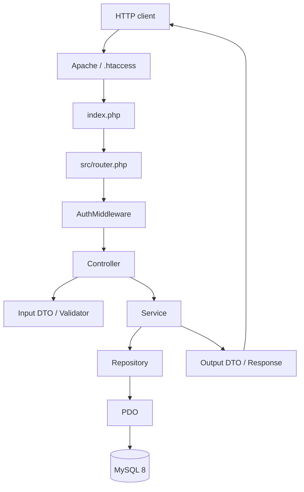
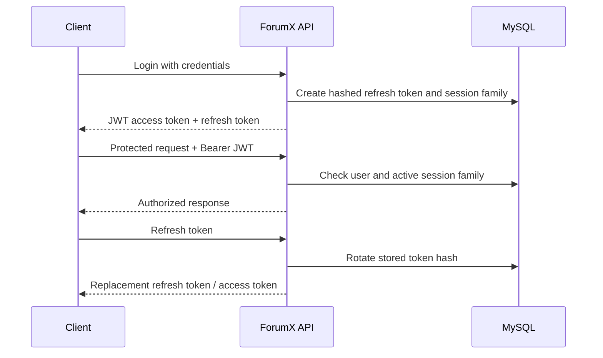
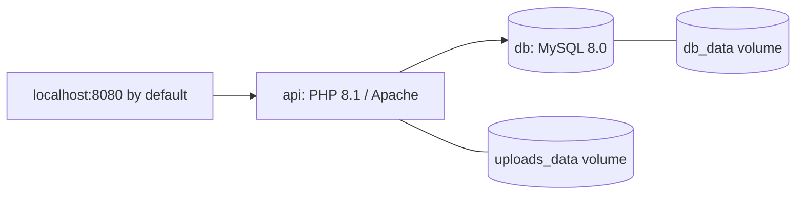

# Architecture

ForumX is a framework-free PHP 8.1 REST API. Routing, application logic and persistence are separated into explicit layers.

## Request flow

The diagram shows the logical flow; individual controllers may call DTOs and validators in different orders.

## Responsibilities

| Location | Responsibility |
| --- | --- |
| `index.php`, `src/router.php` | Request entry point, route matching and controller dispatch |
| `src/Middleware/AuthMiddleware.php` | JWT validation, active-session lookup and role checks |
| `src/Controllers/` | HTTP handlers and orchestration |
| `src/DTOs/`, `src/Validators/` | Input/output structures and validation |
| `src/Services/` | Authentication, content and moderation rules |
| `src/Repositories/` | Database queries and persistence |
| `src/Database/Database.php` | Shared PDO connection (MySQL, `utf8mb4`) |
| `src/Http/Response.php` | JSON success and error envelopes |

## Authentication and sessions

- Access tokens use **HS256 JWT** with a **2-hour** expiry and include user ID and session-family ID.
- Refresh tokens are random values stored as **SHA-256 hashes**. The initial refresh lifetime is 30 days, bounded by a 90-day family expiry.
- Logout/session revocation is checked against MySQL, so a valid JWT alone does not guarantee access.
- Routes declare `guest`, `user` or `admin` access in `src/router.php`; resource ownership checks are handled by application logic.

## Infrastructure

`compose.yaml` exposes the API, not the MySQL port. The database schema is mounted into MySQL's first-run initialization directory. Uploaded files live in a named Docker volume.

See [Installation](INSTALLATION.md) for commands and [Security](SECURITY.md) for limitations.
